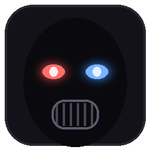

<p align="center"></p>

# SIB Studio Mixer
### Shadows in the Booth Studio Mixer

**Created by Tevin Dahl (Red Eyes) and Erik Lewis (Blue Eyes).**

SIB Studio Mixer is a Windows recording and mixing studio for rap vocals over pre-made beats. Load a beat,
record (or import) your verses, and press **Auto-Match**. SIB listens to the beat, works out its key, tempo and real
tuning, and sets up every vocal track to match: auto-tune locked to the key, breath control, noise cleanup, studio EQ,
compression, de-essing, delay and reverb synced to the tempo, the vocal level set against the beat, and room carved
in the beat so the words cut through. Every setting stays open for you to change.

It covers everything you'd normally open Adobe Audition for on a rap session, and it can still
**export a native Audition session (.sesx)** whenever you want to finish something in Audition.

---

## What it does

### Record over the beat
- Multitrack timeline: beat track plus as many vocal tracks as you want (Lead, Double, Ad-lib, Hook, Harmony roles)
- One-click recording on the armed track, with a **count-in**, **metronome** locked to the beat's BPM, **input monitoring** and a live input meter
- **Loop recording.** Every pass round the loop becomes a new take stacked on the same track. Right-click > *Use this take* to comp
- Automatic latency compensation plus a manual offset, so takes land on the beat
- Clipping/quiet warnings after each take

### Edit like Audition
- Move, trim and fade clips; snap to the beat grid (Alt = free); drag clips between tracks
- Range select across tracks: cut, copy, paste, delete, **ripple delete**, split, trim to selection, duplicate, nudge
- Unlimited-style undo/redo (60 steps). Edits never overwrite your original recordings
- Markers (Intro/Verse/Hook/Bridge/Outro buttons), loop region, zoom, follow-playhead
- **Process menu** (destructive, like Audition's Waveform editor): amplify, normalize (peak or LUFS), fade in/out,
  silence, reverse, invert, noise print + noise reduction, de-click, de-plosive, de-hum, pitch shift, time stretch,
  and *Apply any FX-rack effect to the selection*
- Bounce track (print effects), instant doubles, duplicate tracks, mixer with faders/pan/mute/solo

### Make vocals sound like the studio
- **SIB Tune** auto-tune: key + scale (12 scales), retune speed, humanize, Flex-Tune, note stickiness, transpose,
  formant/throat, and a **beat-tuning lock** (many beats aren't at A440; SIB measures the real A4 and tunes to it).
  It resynthesises with PSOLA, which keeps the voice's formants natural
- **Breath control:** detects every breath, shows each one on the timeline for review, then reduces, targets or mutes
  them with fades. Timing never changes, so you stay in the pocket
- Noise reduction, hum removal, de-click (mouth noise), de-plosive (P/B pops), noise gate/expander
- Parametric vocal EQ with a live curve, compressor (incl. parallel), de-esser, **Vocal Rider** auto-level, multiband,
  saturation (tape/tube/warm/hard), exciter, lo-fi, telephone, doubler, harmonizer (in-key harmonies), chorus,
  tempo-synced delay (ping-pong, dotted/triplet), reverb (BPM-synced pre-delay), stereo width, limiter
- **11 style chains:** Clean Rap Lead, Hard Auto-Tune (Trap), Melodic Rap, Drill/Aggressive, Boom Bap, Lo-Fi/Phone,
  Ad-libs, Doubles/Stacks, Hook/Chorus, Whisper, Raw. Save your own chains as presets
- A/B button to compare dry against processed instantly, plus a per-track FX bypass

### Auto-Match: SIB listens to the beat
1. **Beat analysis:** key and scale with confidence (plus the next most likely keys), BPM with half/double alternatives,
   beat grid start, real tuning (A4 Hz), loudness (LUFS), how crowded the vocal frequency range is
2. **Vocal analysis:** pitch range, rapped vs sung, sibilance frequency, noise floor, tone balance, level, timing vs the grid
3. **Settings written for you:** SIB Tune key/scale/tuning and style (natural for rap, tighter for melodic, or hard),
   HPF from your lowest note, EQ moves compared with a reference rap-vocal tone and adjusted for how busy the beat is,
   de-esser on *your* sibilance frequency, noise reduction from your noise floor, compressor threshold from your level,
   reverb decay/pre-delay and delay times from the BPM, track volume so the vocal sits at a chosen loudness above
   the beat, **Beat Carve** (sidechain dynamic EQ that dips the beat's 2–4 kHz only while you rap), and an optional
   timing nudge onto the grid
- **Pitch / Key tab:** graph of the notes you rapped/sang against the notes in key, before and after tuning,
  with a key guess from your melody alone ("Use the vocal's key")

### Finish
- Export mixdown to WAV (16/24/32-float), MP3 320, FLAC, for the whole song, the selection or the loop
- Mastering chain: glue compression, tone, width, and limiting to a **LUFS target** (-14 streaming / -9 to -11 loud) with a true-peak ceiling
- Stems, with or without effects
- **Export to Adobe Audition:** writes a `.sesx` multitrack session with every track, clip position, fade, clip gain,
  volume, mute, tempo and marker (plus optional breath markers), and opens it in Audition. Choose processed tracks,
  dry editable clips, or both

---

## Install (Windows 10/11)

**Option A: one click (recommended)**
1. Install **Python 3.11+** from [python.org](https://www.python.org/downloads/) and tick **"Add python.exe to PATH"**.
2. Download this repo (green **Code** button > *Download ZIP*) and unzip it.
3. Double-click **`Install SIB Studio.bat`**. It sets everything up and puts a **SIB Studio Mixer** shortcut on your desktop.
4. Optional, for MP3/M4A beats and MP3 export: run `winget install ffmpeg` in a terminal.

**Option B: standalone .exe (no Python needed)**
- Every push to GitHub builds the app automatically (*Actions* tab > latest run > download **SIB-Studio-Mixer-Windows**),
  and tagging a version (e.g. `v1.0.0`) attaches the zip to a GitHub Release.
- Or build it yourself: double-click `build_exe.bat`. You get `dist\SIB Studio Mixer\SIB Studio Mixer.exe`.
  Zip that folder to share it.

**Option C: from source**
```
pip install -r requirements.txt
python -m sib_studio
```

---

## Your first song in 2 minutes
1. **Ctrl+B** to import the beat. SIB analyses it (key, BPM, tuning appear in the toolbar).
2. **Tools > Audio settings:** pick your interface/mic and headphones. Devices marked **[Windows WASAPI]** or **[ASIO]** give the lowest latency.
3. Click **●** on *Lead Vocal*, put on headphones, press **R**. You get a 1-bar count-in, then you're recording. **Space** stops.
4. Record doubles and ad-libs on their tracks the same way, or **Track > Make instant double**.
5. Press **Ctrl+M** (Auto-Match), then **Space** to listen. Tweak anything in the **FX Rack**.
6. **Breaths** tab > *Detect* > review > *Apply* (if Auto-Match's automatic breath control isn't enough).
7. **Ctrl+E** to export, or **Ctrl+Shift+A** to export to Audition.

Full guide: [docs/USER_GUIDE.md](docs/USER_GUIDE.md) · Every effect and setting: [docs/EFFECTS_REFERENCE.md](docs/EFFECTS_REFERENCE.md)

### Keyboard
`Space` play/stop · `R` record · `L` loop · `S` split · `M` marker · `Del`/`Shift+Del` delete/ripple ·
`Ctrl+X/C/V` · `Ctrl+D` duplicate · `Alt+←/→` nudge · `Ctrl+Z/Y` · `=`/`-`/`F` zoom · `Ctrl+M` Auto-Match ·
`Ctrl+wheel` zoom · `Shift+wheel` scroll · `Shift+drag` on the ruler sets the loop

---

## Command line (batch processing)
```
python -m sib_studio cli analyze beat.mp3
python -m sib_studio cli mix --beat beat.mp3 --vocal verse1.wav verse2.wav --adlib adlibs.wav ^
       --style "Hard Auto-Tune (Trap)" --out song.wav --stems --audition
python -m sib_studio cli styles
```

## Project files
A project is a folder: `Song.sibproj` (settings) + `Audio\` (every recording and edit as WAV) + `Exports\` + `Audition\`.
Originals are never modified; each edit writes a new file, which is what makes undo safe.

## Code layout
```
sib_studio/
  core/            audio engine (no GUI): dsp, analysis, pitch (YIN + PSOLA tune), breath, effects registry,
                   presets, project model + undo + editing, automatch, audition (.sesx), cli
  gui/             PySide6 interface: main_window, timeline, fx_panel, panels, dialogs, audio_engine (record/play)
tests/             engine tests on synthetic audio (python -m pytest -q tests)
```

## Credits
- **Tevin Dahl (Red Eyes)** and **Erik Lewis (Blue Eyes)**: creators
- Built with numpy, SciPy, PySide6 (Qt), sounddevice (PortAudio) and soundfile (libsndfile)
- `.sesx` layout modelled on Audition CC sessions as documented by the open-source
  [audition-ses-to-sesx-converter](https://github.com/outhud/audition-ses-to-sesx-converter) (MIT)
- Starting settings are based on published hip-hop mixing practice (iZotope, Sage Audio, MusicRadar, Antares, Sound On Sound guides on
  rap vocal chains, de-essing, breath control and pitch correction)
