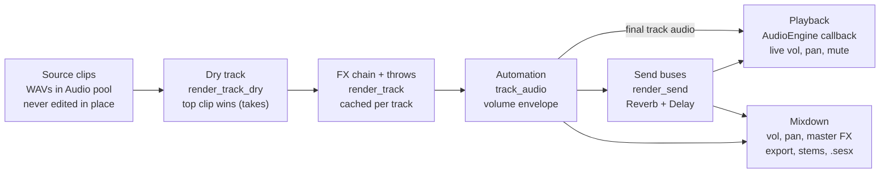

# SIB Studio Mixer — Handoff

Nov 21, 2026 · Live version: [SIB Studio Mixer — Handoff](https://claude.ai/artifact/Lj15fThVcCoQUsRxCsxtpy)

## Summary

SIB Studio Mixer (Shadows in the Booth Studio Mixer) is at version 1.1.0: a Windows desktop studio for recording and mixing rap vocals over pre-made beats. The code is written and its engine is tested, but it has never been launched on a real Windows machine. It is on GitHub on branch `sib-studio-mixer`, not yet merged into `main`.

- **Creators:** Tevin Dahl (Red Eyes) and Erik Lewis (Blue Eyes). The credits are in Help > About and the README.
- **Purpose:** replace Adobe Audition for their workflow. That means recording over beats, editing and tuning vocals, blending them with the beat, writing lyrics, and exporting. It can also exchange sessions with Audition (.sesx export and import).
- **Stack:** Python 3.11+, numpy/SciPy DSP engine, PySide6 (Qt) interface, sounddevice (PortAudio) for record/playback, soundfile (libsndfile) for audio files. FFmpeg is optional, for MP3/M4A.
- **Size:** about 12,500 lines of Python. There are 46 effects with 247 settings and 11 vocal style presets. Three commits (v1.0, v1.1, this handoff) sit on branch `sib-studio-mixer`.

## Where everything is

The code is on GitHub: [tdprinting/Rap-music-voice-program](https://github.com/tdprinting/Rap-music-voice-program), branch [`sib-studio-mixer`](https://github.com/tdprinting/Rap-music-voice-program/tree/sib-studio-mixer), pushed on 21 Nov 2026. The commits are rebased on top of the repo's initial commit, and `main` still holds only that initial README.

| Item | Location | Notes |
| --- | --- | --- |
| Source code | GitHub branch `sib-studio-mixer`; also `SIB-Studio-Mixer-v1.1.zip` (sent in chat) | GitHub is the source of truth. The zip predates the rebase, so its commit ids differ |
| Git branch | `sib-studio-mixer` | On GitHub: `c1480c5` v1.0, `0969cb9` v1.1, then the handoff commit, on top of `fd41d68` (initial commit) |
| Older zip | `SIB-Studio-Mixer.zip` (v1.0) | Superseded by v1.1 |
| Logo | `SIB_Studio_Mixer_logo.png` (2400×1000), `SIB_Studio_Mixer_icon.png` (1024×1024) | Also in the repo as `assets/logo.png`, `assets/logo_square.png`, `assets/sib.ico`, `assets/sib.png`. The generator script is `assets/make_logo.py` |
| User projects | `Documents\SIB Studio Projects\<Song>\` | `<Song>.sibproj` (JSON) + `Audio\` + `Exports\` + `Audition\` |
| User presets | `%APPDATA%\SIB Studio Mixer\presets\` | One JSON per saved FX chain |
| Ad-lib library | `%APPDATA%\SIB Studio Mixer\adlibs\` | WAV + JSON per ad-lib, plus `.starter_done` flag |
| App settings | Windows registry via QSettings (`SIB` / `SIB Studio Mixer`) | Audio devices, buffer, latency, recent files, window geometry |

To make it the main code: open a pull request from `sib-studio-mixer` into `main` on GitHub and merge it.

## Getting it running

On Windows, install Python 3.11+ (tick "Add python.exe to PATH"), then double-click `Install SIB Studio.bat`. It creates `.venv`, installs `requirements.txt` and adds a desktop shortcut.

| Task | How |
| --- | --- |
| Launch | `SIB Studio Mixer.bat`, the desktop shortcut, or `python -m sib_studio` |
| Open a project from the command line | `python -m sib_studio path\to\Song.sibproj` |
| Run engine tests | `python -m pytest -q tests` (13 tests, about 15 s) |
| GUI smoke test | Set `QT_QPA_PLATFORM=offscreen` and `SIB_SMOKE_TEST=1`, then run `python -m sib_studio`. The window opens and closes itself after 1.5 s |
| Build standalone exe | `build_exe.bat` produces `dist\SIB Studio Mixer\SIB Studio Mixer.exe` (PyInstaller, bundles `assets` and `sib_studio/data`) |
| CI | `.github/workflows/build-windows.yml` runs on push to `main`, on PRs and on `v*` tags. It runs the tests and the smoke test, builds the exe, uploads `SIB-Studio-Mixer-Windows.zip`, and attaches it to a release on tags |
| MP3/M4A support | `winget install ffmpeg`. Optional; WAV/FLAC work without it |

Command-line tools for batch work:

```
python -m sib_studio cli analyze beat.mp3
python -m sib_studio cli mix --beat beat.mp3 --vocal v1.wav --adlib ad.wav --style "Hard Auto-Tune (Trap)" --out song.wav --stems --audition
python -m sib_studio cli styles
```

CI also runs on pull requests, so a PR from `sib-studio-mixer` into `main` runs the tests, the smoke test and the exe build before anything is merged.

## Feature inventory

v1.0 covers the recording studio and the vocal chain. v1.1 adds writing, ad-libs, editing, mixing tools and Audition import. The full user-facing detail is in `docs/USER_GUIDE.md` (sections 1–20), and every effect setting is in `docs/EFFECTS_REFERENCE.md` (generated from the effect registry).

| Area | Version | What exists | Main code |
| --- | --- | --- | --- |
| Lyrics pad | 1.1 | Rhyme colouring (end / all / strict), bar and syllable gutter, templates, `{2}` multi-bar lines, LRC/TXT in and out, section markers | `core/lyrics.py`, `gui/lyrics_panel.py` |
| Rhyme finder | 1.1 | Perfect, multi and slant rhymes from CMUdict, ranked by subtitle word frequency, with slang fallback | `core/lyrics.py` |
| Teleprompter | 1.1 | Separate window, karaoke wipe, count-in, next lines, full screen, mirror, tap-sync (T) | `gui/teleprompter.py`, `gui/features.py` |
| Ad-lib library | 1.1 | Save a selection with 10 styles, search, favourite, insert once or every N bars, zip packs, 6 generated FX | `core/adlibs.py`, `gui/tool_panels.py` |
| Punch in/out | 1.1 | Record only inside a selection, 1-bar pre-roll, auto-stop | `gui/audio_engine.py` |
| Take Coach | 1.1 | 0–100 score plus tips per take (level, clipping, noise, timing, pitch, pops, esses, breaths) | `core/coach.py` |
| Vocal tools | 1.1 | Strip silence, align to lead, quantize phrases, spectral repair, throws, stutter, tape stop/start, filter sweeps | `core/vocal_edit.py`, `core/dsp.py` |
| Mixing | 1.1 | Volume automation, shared Reverb and Delay buses, reference A/B, Match EQ, analyzer with masking finder | `core/project.py`, `gui/tool_panels.py` |
| Beat tools | 1.1 | Transpose, change tempo, beat drop, vocal remover | `core/vocal_edit.py` |
| Audition import | 1.1 | `.sesx` tracks, clips, fades, gains, tempo, markers, effects, sends, plug-in mapping, report | `core/audition_import.py` |
| Recording | 1.0 | Multitrack over a beat, count-in, metronome, monitoring, loop takes, comping, latency compensation | `gui/audio_engine.py`, `gui/main_window.py` |
| Editing | 1.0 | Move, trim, fades, snap, cut/copy/paste, ripple delete, split, 60-step undo, Process menu | `core/project.py`, `gui/timeline.py` |
| Auto-Match | 1.0 | Beat key/BPM/tuning/loudness analysis, then automatic vocal chain, level and Beat Carve setup | `core/automatch.py`, `core/analysis.py` |
| SIB Tune | 1.0 | YIN pitch tracking + PSOLA auto-tune with key, scale, retune, humanize, flex-tune, formant | `core/pitch.py` |
| Breath control | 1.0 | Detect, review and reduce breaths without moving timing | `core/breath.py` |
| Export | 1.0 | WAV/MP3/FLAC mixdown, mastering to a LUFS target, stems, `.sesx` export | `core/audition.py`, `gui/main_window.py` |

## Architecture and code map

`sib_studio/core` is the whole audio engine with no GUI imports. `sib_studio/gui` is the PySide6 interface on top of it, so engine changes can be tested headlessly with pytest.



Each track's dry audio goes through its FX chain once and is cached by a hash of its clips, effects and project key/tempo. Playback and export both read that cache. Editing a clip or an effect re-renders only that track; volume, pan, mute and solo never re-render.

| Module | Responsibility |
| --- | --- |
| `core/project.py` | Project, Track, Clip, Marker; AudioPool; render cache; sends; mixdown; save/load; UndoStack; edit ops (split, delete_range, paste, process_range, bounce) |
| `core/effects.py` | Effect registry: each effect's `Param` list (UI and docs are generated from it) and `process_chain` |
| `core/dsp.py` | Filters, dynamics, repair, colour, space, time/pitch, v1.1 creative and spectral functions |
| `core/pitch.py` | YIN pitch tracking, correction curve, PSOLA resynthesis (SIB Tune, harmonizer) |
| `core/analysis.py` | Key, tuning, tempo, LUFS, band energies |
| `core/automatch.py` | Beat + vocal analysis that writes chain settings and levels |
| `core/lyrics.py`, `adlibs.py`, `vocal_edit.py`, `coach.py`, `breath.py`, `presets.py` | Feature engines named after their feature |
| `core/audition.py`, `audition_import.py` | `.sesx` export and import |
| `gui/main_window.py` + `gui/features.py` | Menus, transport, record/play flow, editing commands; v1.1 features live in `FeatureMixin` |
| `gui/audio_engine.py` | sounddevice duplex stream, mixing callback, metronome, count-in, punch, analyzer ring buffer |
| `gui/timeline.py` | Ruler, track headers, lanes (cached pixmap; playhead drawn as an overlay), automation editing |
| `gui/fx_panel.py`, `panels.py`, `lyrics_panel.py`, `teleprompter.py`, `tool_panels.py`, `dialogs.py` | Inspector tabs, mixer, dialogs |

Project format: `<Song>.sibproj` is JSON (tracks, clips, effect instances as `{uid, id, enabled, params}`, markers, lyrics, sends, analysis). Audio lives in `Audio\*.wav` (float32). Destructive edits write a new WAV, so undo restores a snapshot of the JSON state and never touches audio. Undo deliberately keeps lyrics as they are, so it never rewinds writing.

Heavy work (rendering, analysis, import) runs through `gui/workers.run_task` on a QThreadPool; results come back to the UI thread by signal.

## Testing status

The audio engine is well tested on synthetic audio. The interface has only been run against a fake Qt layer, never on real Windows with real Qt, a real audio device or a real voice.

| What | How it was checked | Result |
| --- | --- | --- |
| Engine (DSP, analysis, tune, breaths, project, import/export) | 13 pytest tests in `tests/test_core.py` and `tests/test_v11.py`, on generated vocals and beats | All pass |
| Key / BPM / tuning detection | Synthetic A-minor beat at 90 BPM; a beat detuned +30 cents | Detected A minor, 90 BPM, +30.2 cents |
| SIB Tune | Off-key test notes, retune 5 ms | Within 0.12 semitone of the target notes |
| Align to lead | Double recorded 30 ms late | Pulled back to within 8 ms |
| Audition round-trip | Export to `.sesx`, then import | Clip positions, fades, gain, volume, tempo and markers identical |
| Real Audition file | A French-language `.sesx` from the open-source Duik project | Imported, including finding its media |
| GUI logic | `gui_test.py` in the build sandbox (not in the repo) drives the main window through stub PySide6 and sounddevice modules | Every v1.0 and v1.1 action runs without errors |
| Record / playback timing | Fake audio device calling the engine callbacks | Count-in, loop takes, punch range and latency trimming correct |
| Performance | 3-minute stereo vocal | Auto-tune about 3.6 s; each other effect under 3 s |

Never done:

- Launching the real window on Windows (painting, layout, Qt enum names, signal arity).
- Recording through a real interface, including latency on WASAPI or ASIO and the WASAPI sample-rate fallback.
- Opening real Audition sessions that contain effect racks. The effect parameter mapping is untested against real values.
- Listening tests on real rap vocals: whether the presets, Auto-Match and breath detection sound right.
- Building the PyInstaller exe.

## Known limitations and risks

The biggest risk is a startup or layout bug the first time the real window opens. Running the CI smoke test catches the startup crash cases before anyone tries it.

| Risk | Impact | Mitigation |
| --- | --- | --- |
| GUI never run on real Qt | First launch may crash or mis-draw | Open a PR so CI runs the offscreen smoke test, then fix whatever it reports |
| Effects render offline, not live | Changing a heavy effect (SIB Tune) during playback takes 1–3 s to be heard | By design: tracks are pre-rendered and the audio callback only mixes. A future fix is per-effect real-time processing |
| Send buses are pre-fader and ignore pan | Bus level doesn't follow fader moves | Documented behaviour. Change in `Project.render_send` if post-fader sends are wanted |
| Audition effect settings are approximate | Imported racks sound close, not identical | Audition stores settings as 0–1 values, mapped by name. The import report lists every mapping |
| Third-party plug-ins can't be read | Auto-Tune, FabFilter etc. become SIB defaults | Mapped to the nearest SIB effect. Unknown ones become bypassed placeholders |
| Audition pan is not exported | Pan in exported `.sesx` is baked into processed audio; dry tracks come in centred | Audition's internal pan scale is undocumented |
| Old binary `.ses` files | Not supported | Only `.sesx` (Audition CC 2015+) |
| Rhyme quality for slang | Unknown words use a spelling guesser | Good for common rap spellings ("drippin"), weaker for invented words |
| Pitch editing is display-only | The Pitch tab graphs notes but can't drag them | `correction_curve` already accepts `frozen_notes`; the UI to edit them is not built |
| Memory use | Every edit writes a new WAV and keeps it for undo | Fine for songs; long sessions grow the `Audio` folder |
| Package installs | Install needs internet | `Install SIB Studio.bat` uses pip; the exe build avoids that for end users |

## Next steps

Get it through a real Windows launch first; everything else depends on that.

- [ ] Open a pull request from `sib-studio-mixer` into `main` so CI runs, then merge it. (The branch was pushed on 21 Nov 2026.)
- [ ] Read the CI run. If the offscreen smoke test fails, fix the startup error it reports.
- [ ] Install on both artists' PCs with `Install SIB Studio.bat` and open the app.
- [ ] Set up audio in Tools > Audio settings: pick a WASAPI or ASIO device, buffer 256–512, and record a test take to set the latency fix.
- [ ] Run a real session: import a beat, record a verse, Auto-Match, export. Note anything that sounds wrong (preset levels, tune strength, breath detection).
- [ ] Import one of their real Audition sessions and check the import report against what Audition shows.
- [ ] Tag `v1.1.0` so CI attaches the exe zip to a GitHub release they can share.
- [ ] Later: note-level pitch editing in the Pitch tab, post-fader sends, and live effect processing during playback.

## Third-party data, licences and credits

Two bundled data files carry licence terms that must stay with any copy of the app. Both licence files are in `sib_studio/data/`. The repo itself has no LICENSE file yet; the owners should pick one.

| Component | Use | Licence |
| --- | --- | --- |
| CMU Pronouncing Dictionary (`cmudict.dict.gz`) | Syllables and rhymes | BSD-style, see `CMUDICT_LICENSE.txt` |
| FrequencyWords by Hermit Dave, OpenSubtitles 2018 (`word_freq.txt.gz`) | Ranking rhyme suggestions | CC BY-SA 4.0, attribution required, see `WORD_FREQ_LICENSE.txt` |
| audition-ses-to-sesx-converter (outhud) | Reference for the `.sesx` XML layout (no code copied) | MIT, credited in the README |
| numpy, SciPy, PySide6, sounddevice, soundfile, optional numba | Runtime dependencies | Their own open-source licences (BSD, LGPL for Qt/PySide6, MIT) |

Creators: Tevin Dahl (Red Eyes) and Erik Lewis (Blue Eyes). They are shown in Help > About and in the README.
